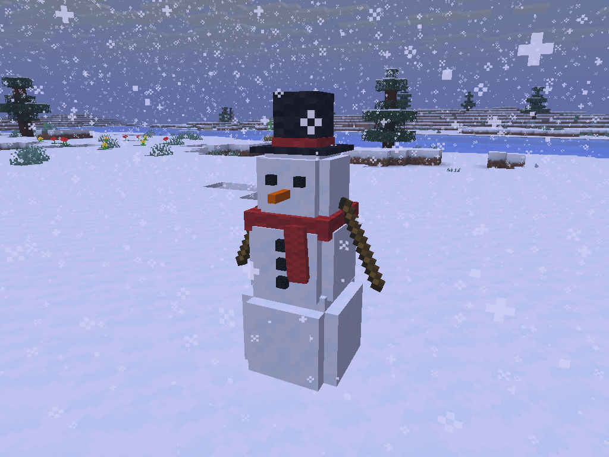
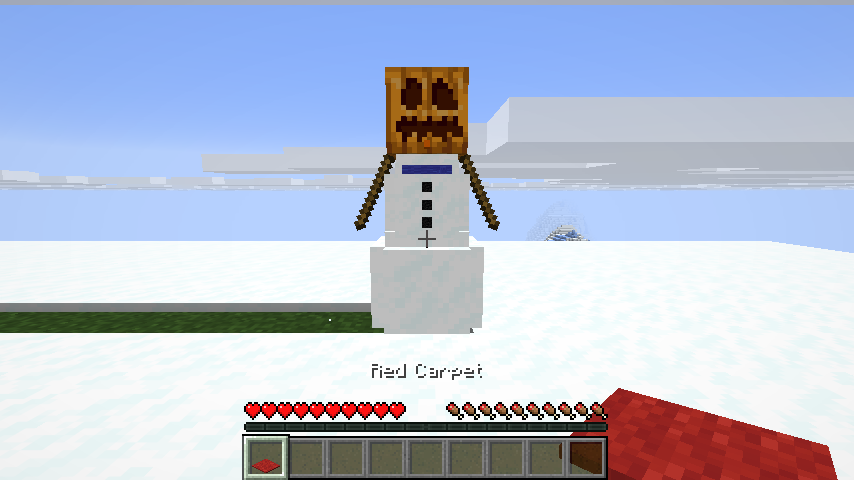
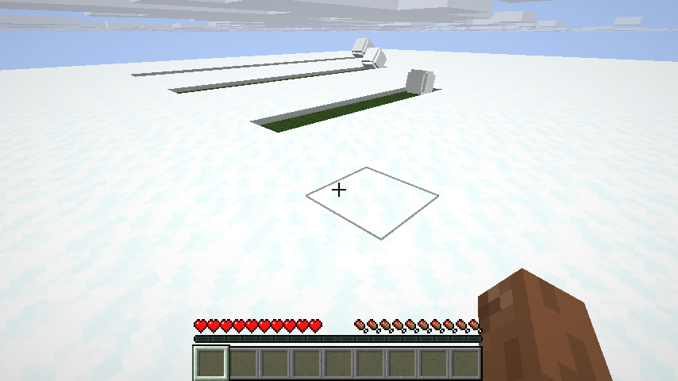

# Snowman

**Build a real snowman.** Roll a snowball through the snow and watch it grow, stack three, then give it a face, arms, a scarf and a hat.

## How it works

1. **Pack a snowball:** right-click snow with an empty hand
2. **Roll it:** walk into it to push it through the snow, or hit it to kick it. It grows with every block of snow it picks up and leaves a trail of grass behind. There's no size limit, so go build a giant
3. **Stack it:** right-click a snowball to pick it up, then right-click a bigger (or same-size) one to put it on top. Three make a snowman, and you can go up to five for a really tall one
4. **Decorate it:** right-click your finished snowman with
   - **coal** for eyes and buttons
   - a **carrot** for the nose
   - **sticks** for arms
   - a knitted **Scarf**, in any colour you dye it
   - a **Top Hat** you can craft, and your snowman never melts
   - **anything else** for a hat: a bucket, a pumpkin, a flower, a helmet

Every snowman turns out different, because you decide how big each snowball gets. Picked-up snowballs keep their size, and you can see it in your inventory.

## Good to know

- Press **R** next to your snowman to turn it
- Snowy sounds for every step
- Sneak and right-click to take decorations off again
- Hit a snowman twice to knock it over and get everything back
- Snowmen slowly melt in deserts and the Nether, unless they wear a Top Hat
- Top Hat recipe: black wool on top, red dye in the middle, three black wool at the bottom
- Scarf recipe: three wool in a row, one more under the right end; dye it like leather armor
- Settings: turn melting or the snow trail off, or change how big snowballs can grow
- Install it on the server and on every client: it adds new items
- Fabric, Forge and NeoForge, Minecraft 26.1 to 26.3
- Requires [Mycel](https://www.curseforge.com/minecraft/mc-mods/mycel). Without it the game still starts, and Snowman tells you in chat that Mycel is missing
